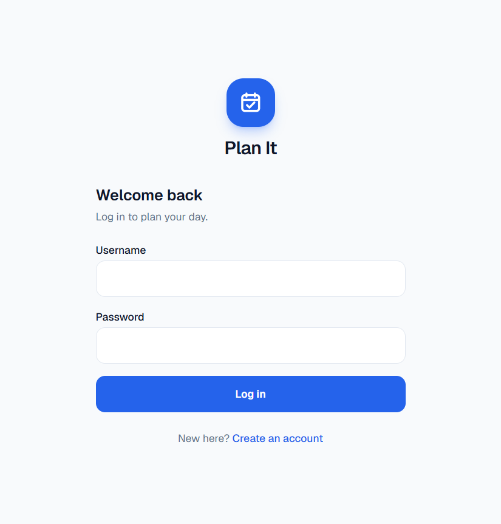
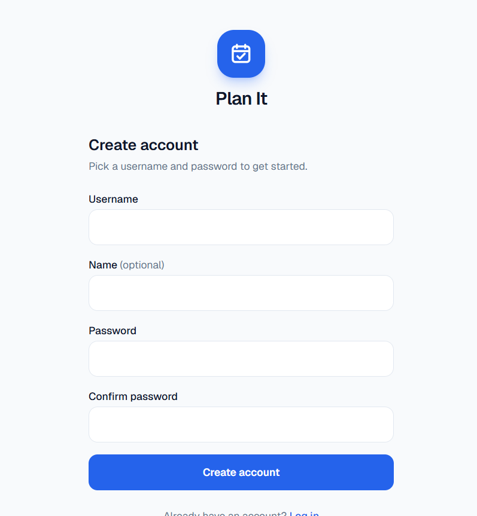
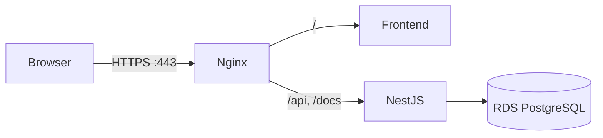

# Plan It

Next.js PWA frontend for a personal planner — home, calendar, goals, habits, tasks, reminders, and profile.  
Talks to the NestJS API via `NEXT_PUBLIC_API_URL`.  
**Live at [my-planit.duckdns.org](https://my-planit.duckdns.org), hosted on AWS (EC2 + RDS).**

## Live demo

| | |
| --- | --- |
| App | [https://my-planit.duckdns.org](https://my-planit.duckdns.org) |
| API docs (Swagger) | [https://my-planit.duckdns.org/docs](https://my-planit.duckdns.org/docs) |
| API base | `https://my-planit.duckdns.org/api` |

Production runs on a single AWS `t3.micro` **EC2** instance with **RDS** (PostgreSQL), **Nginx**, and **HTTPS** (Let’s Encrypt on DuckDNS).  
Nginx serves this PWA at `/` and proxies `/api` + `/docs` to NestJS on the same host.

### Screenshots

Login (Plan It branding):



Create account:



## Features

- **Home** — today summary, week strip, timed timeline, untimed tasks, overdue
- **Calendar** — day / week / month views, plus weekly review in the week view
- **Tasks** — priority, notes, start/end time, projects, tags, recurrence, subtasks, reminders
- **Goals & habits** — dedicated pages with create/edit sheets and habit check-ins
- **Web Push** — browser reminders for `reminderAt` (enable from Profile)
- **PWA** — installable app with splash, manifest, and service worker
- **Auth & profile** — login/register, JWT session, avatar upload

## Tech stack

- **Next.js** (App Router) + **React** + **TypeScript**
- **Tailwind CSS** — UI
- **TanStack Query** + **Axios** — API data fetching
- **React Hook Form** + **Zod** — forms and validation
- **PWA** (`manifest.webmanifest` + service worker) — installable on mobile/desktop
- **Nginx** on **AWS EC2** — static/export serve + TLS; API on the same origin under `/api`

## Architecture

```text
                    HTTPS (443)
                         │
                         ▼
              ┌─────────────────────┐
              │   Nginx on EC2      │
              │   (TLS + routing)   │
              └─────────┬───────────┘
                        │
          ┌─────────────┼─────────────┐
          ▼             ▼             ▼
     Frontend        NestJS        /docs
     (this app)    (/api → :3001)  (proxied)
                        │
                        ▼
                 Amazon RDS
                 (PostgreSQL)
```



## Deployment on AWS

Plan It is deployed as a small portfolio stack on AWS:

- **EC2 (`t3.micro`)** — one VM runs the built Next.js/PWA frontend and the NestJS API process.
- **RDS (PostgreSQL)** — managed database separate from the app VM.
- **Nginx** — TLS termination + routing on `my-planit.duckdns.org`: `/` → frontend, `/api` and `/docs` → NestJS (one origin, no production CORS pain).
- **HTTPS (Let’s Encrypt)** — required for secure login/JWTs and for **Web Push** in the browser.
- **Same-host API** — production `NEXT_PUBLIC_API_URL` is `https://my-planit.duckdns.org/api`.

This is a learning / portfolio deploy, not a multi-AZ or auto-scaling setup.

## Run locally

```bash
copy .env.example .env.local
npm install
npm run dev
```

App: http://localhost:3000

Set `NEXT_PUBLIC_API_URL` to the API base (local default `http://localhost:3001`).  
The NestJS API should already be running — see the [plan-it-backend](../backend) repo (or your backend remote) for Docker/Postgres and `npm run start:dev`.
