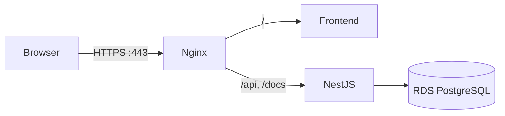

# Plan It

Next.js PWA frontend for a personal planner — home, calendar, goals, habits, tasks, and profile.  
Talks to the NestJS API via `NEXT_PUBLIC_API_URL`.  
**Hosted on AWS (EC2 + RDS).**

## Live demo

| | |
| --- | --- |
| App | [https://my-todo.duckdns.org](https://my-todo.duckdns.org) |
| API docs (Swagger) | [https://my-todo.duckdns.org/docs](https://my-todo.duckdns.org/docs) |
| API base | `https://my-todo.duckdns.org/api` |

Deployed on AWS with **EC2**, **RDS**, **Nginx**, and **HTTPS** (single `t3.micro` instance).  
Nginx serves this frontend at `/` and proxies `/api` (and `/docs`) to the NestJS backend on the same host.

### Screenshots

Login:


Create account:


## Tech stack

- **Next.js** (App Router) + **React** + **TypeScript**
- **Tailwind CSS** — UI
- **TanStack Query** + **Axios** — API data fetching
- **React Hook Form** + **Zod** — forms and validation
- **PWA** (`manifest.webmanifest` + service worker) — installable on mobile/desktop
- **Nginx** on **AWS EC2** — static/export serve + TLS; API on the same origin under `/api`

## Architecture

```text
                    HTTPS (443)
                         │
                         ▼
              ┌─────────────────────┐
              │   Nginx on EC2      │
              │   (TLS + routing)   │
              └─────────┬───────────┘
                        │
          ┌─────────────┼─────────────┐
          ▼             ▼             ▼
     Frontend        NestJS        /docs
     (this app)    (/api → :3001)  (proxied)
                        │
                        ▼
                 Amazon RDS
                 (PostgreSQL)
```



## Deployment choices

- **EC2** — one small VM hosts both the built frontend and the API; simple for a portfolio deploy.
- **Nginx** — one origin for the browser (no CORS headaches in production): `/` → frontend, `/api` → NestJS, plus HTTPS termination.
- **HTTPS** — Let’s Encrypt on the DuckDNS hostname so login and JWTs are not sent over plain HTTP.
- **Same-host API** — production `NEXT_PUBLIC_API_URL` points at `https://my-todo.duckdns.org/api` so the PWA and API share the domain.

This is a learning / portfolio deploy on a single `t3.micro`, not a multi-AZ or auto-scaling setup.

## Run locally

```bash
copy .env.example .env.local
npm install
npm run dev
```

App: http://localhost:3000

Set `NEXT_PUBLIC_API_URL` to the API base (local default `http://localhost:3001`).  
The NestJS API should already be running — see the [plan-it-backend](../backend) repo (or your backend remote) for Docker/Postgres and `npm run start:dev`.
